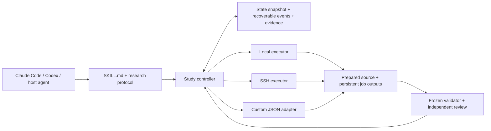

# Scientist Two Skill

[中文](README.zh-CN.md) · [Workflow and schema](references/workflow.md) · [Executor contract](references/executor-contract.md)

A portable research workflow for **Claude Code, Codex, and other agents that read skills and execute commands**. The agent reasons about science; a small Python execution layer records evidence, finite budgets, durable jobs, and five stage gates. No model SDK, API key, GPU, database, or hosted service is required for the demonstration.

This is an **independent, unofficial adaptation** of [ScientistTwo](https://arxiv.org/abs/2609.19644), with the bounded baseline/experiment/keep-or-discard pattern inspired by [Karpathy's autoresearch](https://github.com/karpathy/autoresearch). The paper's six workflow modules are adapted into five gates here. We have **not reproduced its scientific performance**. The paper reports 86/107 (80.4%) benchmark improvements; its final integrity audit covers 49 tasks and 1,814 references. Those are the authors' results in their evaluated setting, not product guarantees. See [source and license checks](references/sources.md).



## Install

Runtime: **Python 3.10+ on Linux or macOS**, a filesystem supporting POSIX locks and atomic replacement, and OpenSSH for SSH mode. The controller and worker use POSIX process groups; native Windows is not supported (use a suitable Linux environment). No Python packages are needed.

Clone the repository once:

```sh
git clone https://github.com/doubaoclaude-dotcom/scientist-two-skill.git
cd scientist-two-skill
```

Choose the appropriate installation destination. Run from the clone; the destination must not already exist:

```sh
# Claude Code: personal skill
mkdir -p "$HOME/.claude/skills"
test ! -e "$HOME/.claude/skills/scientist-two" && \
  cp -R . "$HOME/.claude/skills/scientist-two"

# Codex: personal skill
mkdir -p "$HOME/.agents/skills"
test ! -e "$HOME/.agents/skills/scientist-two" && \
  cp -R . "$HOME/.agents/skills/scientist-two"
```

Alternatively copy the skill directory into the target project's `.claude/skills/scientist-two` or `.agents/skills/scientist-two`, respectively. Keep `scripts/`, `examples/`, and `references/` with `SKILL.md`; do not install only the Markdown file. Claude Code invocation: `/scientist-two`. Codex invocation: `$scientist-two`. Discovery paths are verified against [Claude Code docs](https://code.claude.com/docs/en/skills) and [Codex docs](https://developers.openai.com/codex/skills/). Automatic discovery is enabled; optional Codex UI metadata is in `agents/openai.yaml`. No host-specific model is selected. Compatibility validation covers skill format, documented discovery paths, and portable scripts; interactive Claude Code/Codex research sessions have not been benchmarked.

## Agensi companion

[The Agensi entry](distribution/agensi.md) is a free, MIT-licensed, independent and unofficial planning/review companion. It works without installing the runtime: it provides frozen-protocol planning and S1–S5 evidence requirements, and reports **not executed; gates pending** when no execution has occurred. Optional real execution uses a separately obtained public checkout on existing authorized compute; see [Install](#install) and the [executor contract](references/executor-contract.md). Prefer the user's existing project/Python environment. Existing WSL2 or containers require checks for persistent POSIX storage and worker/process support before use; untested environments are not validated. The package does not provide a terminal, GPU, or hosted compute.

[Listing copy](distribution/agensi-listing.md) accompanies this instruction-only ZIP. From the repository root, rebuild it with Python's standard library (only the entry and MIT license are included; no runtime):

```sh
python3 - <<'PY'
from pathlib import Path
from zipfile import ZipFile, ZIP_DEFLATED
archive = Path('../output/agensi/scientist-two-agensi.zip')
archive.parent.mkdir(parents=True, exist_ok=True)
with ZipFile(archive, 'w', compression=ZIP_DEFLATED) as package:
    package.write('distribution/agensi.md', 'SKILL.md')
    package.write('LICENSE', 'LICENSE')
print(archive.resolve())
PY
```

## Five-minute quickstart

From a clean clone:

```sh
python3 examples/demo.py
python3 examples/demo.py --mode custom
python3 -m unittest discover -s tests -v
```

Observed local demo output (selected fields; 2026-11-05):

```json
{"baseline_score":0.5,"final_score":1.0,"gates":["S1","S2","S3","S4","S5"],"jobs":8,"mode":"local","synthetic":true}
```

The scores are deliberately constructed arithmetic fixture values, not benchmark results.

The demo runs deterministic arithmetic experiments, recomputes metrics from raw observations, and exercises S1–S5. Its reviewer identities and research judgments are **test fixtures**. A passing demonstration is software-loop acceptance, not independent scientific review or a real research finding. Default output goes into an automatically removed temporary directory. To inspect the state and job artifacts, select a fresh directory:

```sh
python3 examples/demo.py --directory /tmp/scientist-two-demo
python3 scripts/study.py --state /tmp/scientist-two-demo/state.json status
```

The demo also writes `config.json`, which illustrates the complete controller configuration. Commands run without model calls or network access. Do not reuse its synthetic reviewer statements for a real study.

## Configure real work

Start with the demo's generated `config.json` and the [full configuration/evidence schema](references/workflow.md). Replace the toy objective, baseline, data splits, metric and direction, minimum improvement, statistical rule, guardrails, stopping conditions, and budgets **before** the first experiment. Record data and evaluator versions. Source and result hash checks are not required by any executor. `source_manifest` is optional controller-local tracking; omit it unless you want local file-change detection. Do not include credentials, datasets, weights, logs, `.git`, or generated results in a source upload.

`commands` holds named argument arrays; the CLI chooses a frozen command instead of accepting untracked shell text. Your experiment writes finite JSON to the path in `SCIENTIST_RESULT_PATH`; `SCIENTIST_JOB_DIR` is available for raw observations and logs. The executor requires numeric `metrics.score`; additional named metrics support the controller's primary metric and guardrails. For example:

```python
import json, os
with open(os.environ["SCIENTIST_RESULT_PATH"], "w") as output:
    json.dump({"metrics": {"score": 0.75}}, output, allow_nan=False)
```

Here `0.75` is an interface example, not measured product performance. Supply a validator that recomputes the task's metrics from evidence and runs the required integrity checks. Its command and files are frozen in the config; it receives JSON on stdin and returns JSON on stdout. Use `examples/validator.py` as a runnable toy example, not a generic proof of scientific correctness. Validators and adapters are trusted executable programs and must receive only the access appropriate to the study. Never persist secrets or a full environment in the configuration or manifests.

```sh
python3 scripts/study.py --state /absolute/study/state.json init --config /absolute/config.json
python3 scripts/study.py --state /absolute/study/state.json submit --job-id baseline-01 --kind baseline --command baseline
python3 scripts/study.py --state /absolute/study/state.json reconcile --job-id baseline-01
python3 scripts/study.py --state /absolute/study/state.json evidence --file /absolute/evidence-s1.json
python3 scripts/study.py --state /absolute/study/state.json gate --stage S1
```

Budget units are **elapsed job wall-seconds**, not CPU-seconds or GPU-hours. The full per-job timeout is reserved before submission and settled from the terminal response. A job consumes one task and one iteration. If GPU resource accounting is required, provide an appropriate authorized adapter/accounting extension; this release does not calculate GPU consumption. No real GPU benchmark is authorized merely by installing the skill.

## Three execution modes

The common protocol provides `submit`, `status`, and `collect`. States are `preparing`, `running`, `succeeded`, `failed`, and `unknown`. See the [executor contract](references/executor-contract.md) for required response fields, bounded JSON, transport failures, and quoting.

**Local** means the controller and compute run on the same host, including a cloud host:

```json
{"executor":{"mode":"local"},"execution":{"cwd":"/absolute/prepared/source","job_root":"/absolute/persistent/jobs"}}
```

Use the controller commands above, or run `python3 examples/demo.py` for a complete local configuration. A detached worker preserves job identity and logs after the caller disconnects.

**SSH** reuses an already configured SSH host alias and host-key trust:

```json
{"executor":{"mode":"ssh","host":"research-host","python":"python3","executor_path":"/srv/scientist/executor.py"},"execution":{"cwd":"/srv/scientist/source","job_root":"/srv/scientist/jobs"}}
```

Prepare the remote paths with permissions for your account. Explicitly copy only the executor and the approved source files, for example:

```sh
ssh research-host 'mkdir -p /srv/scientist/source /srv/scientist/jobs'
scp scripts/executor.py research-host:/srv/scientist/executor.py
scp examples/experiment.py research-host:/srv/scientist/source/experiment.py
```

Adjust those paths to a writable location. The controller's `source_root` is the local approved source tree; `execution.cwd` is its prepared remote counterpart. Use remote-valid argv paths. The worker runs the prepared remote files without checking source or result hashes. A local Git commit alone does not establish remote source identity. No automatic directory mirroring or deletion synchronization occurs. An optional absolute `config_file` selects an existing SSH config with `ssh -F`; host-key checking is retained. Authentication stays in existing SSH facilities. When upgrading an existing deployment, copy the updated `scripts/executor.py` to the remote endpoint as well; the original endpoint still requires checksums.

Use the same `init`, `submit`, and `reconcile` commands with the SSH configuration. Results are returned as JSON; remote raw artifacts stay on the remote host. **Before running a local validator that needs raw artifacts, explicitly collect its allowlisted files and make the validator resolve those local copies.** SSH `collect` is not a general filesystem downloader; a remote-aware validator is another option. Record where the collected artifacts came from; no remote checksums are required.

**Custom** executes an adapter argv array and exchanges one JSON request/response:

```json
{"executor":{"mode":"custom","argv":["python3","/absolute/skill/examples/custom_adapter.py"]},"execution":{"cwd":"/absolute/prepared/source","job_root":"/absolute/persistent/jobs"}}
```

`python3 examples/demo.py --mode custom` exercises the supplied working adapter. Replace its internals with an authorized scheduler or API; maintain stable IDs and truthful state/resource reporting. Example request and successful response (schematic values):

```json
{"operation":"status","job_id":"study01-h01","job_root":"/absolute/persistent/jobs"}
```

```json
{"job_id":"study01-h01","status":"succeeded","exit_code":0,"elapsed_seconds":1.2,"job_dir":"/absolute/persistent/jobs/study01-h01","result":{"metrics":{"score":0.75}}}
```

Only protocol JSON belongs on stdout. Put diagnostics on stderr or in job logs. Malformed, oversized, non-finite, mismatched-ID, and invalid-state responses are rejected. The adapter returns process status and valid result JSON; it does not need to compute or return checksums.

## Gates and recovery

| Stage | Evidence | Gate purpose |
| --- | --- | --- |
| S1 | Matched baseline, diagnosis, falsifiable hypotheses | Fix evaluation and bounded changes |
| S2 | Smoke, development screening, confirmation, resources | Improvement, uncertainty, guardrails and limits |
| S3 | Ablations/interaction groups, simplification, retest | Support retained scientific components |
| S4 | Independent critique, new rebuttal experiments, closure | Address or withdraw fatal empirical claims |
| S5 | Numerical, protocol, citation and code mapping audits | Same final version, no open fatal findings |

The controller checks sequence, artifact identity, evidence version, job completion, metric validity, frozen-validator output, and budgets. Reviewers judge the scientific adequacy of hypotheses, uncertainty, component support, citations, and code semantics. Reviewer identity/independence is a recorded declaration, not authenticated by this software. No independent reviewer means no honest completed scientific review: export a package using `review-package --output /absolute/review.json` and leave the gate pending.

One explicit state path identifies a study. Locking serializes controller updates; events contain full recoverable states and precede atomic snapshots. Reopen with `status`, then `reconcile --job-id SAME-ID`. **Never submit a new ID simply because the previous submission timed out.** Unknown jobs retain their reservation until reconciled. Failed results and negative outcomes stay in history. Inspect job logs under the recorded job directory.

Use `revise --config FILE --reason TEXT` when changing source/configuration/protocol. A version change makes gates stale and preserves old evidence. Reestablish the relevant gates with current-version evidence. Stop with `finish --outcome negative|inconclusive|budget_exhausted --reason TEXT` when justified (choose one outcome, not the literal pipe-separated string). The state file does not wake the host agent after a chat ends. Processes with arbitrary write access can bypass records; this is workflow error prevention, not a security boundary.

## Validation, limits, and contributions

Run `python3 -m unittest discover -s tests -v`. Tests exercise local and custom execution, failures/timeouts/corrupt results, duplicate IDs, unknown recovery, budget and gate failures, version drift, crash recovery, and the deterministic five-stage chain. SSH quoting and disconnect parsing have simulated tests. A real isolated localhost SSH test also passed on macOS; it creates disposable keys and a loopback-only server without editing user SSH files. Run it explicitly with `SCIENTIST_TEST_SSH=1 python3 -m unittest discover -s tests -p test_ssh_real.py -v` (requires `sshd` and permission to start it). This does not test a remote cloud environment. CI checks Python 3.10 and 3.14 on Linux. Tests verify observable software behavior, not scientific truth.

The initial release is intentionally a single-controller, POSIX, file-backed workflow. It has no background agent scheduler, real model benchmark, native Windows support, credential manager, dataset upload system, or automatic remote artifact download. Disk usage of experiment logs/data is not quota-managed. Real training needs your dataset policy, evaluator, frozen benchmark and explicit compute budget. Arbitrary external command dependencies and runtime environments need their own reproducibility records.

Contributions: reproduce a concrete issue with a small test, keep the standard-library runtime and common executor contract, synchronize both READMEs for user-visible changes, and run affected tests. Submit a pull request; do not include datasets, credentials, private addresses, or generated study outputs. Code and original documentation are [MIT licensed](LICENSE). Source projects have their own licenses; [attribution](references/sources.md) explains the separately verified boundaries.

**Software-loop acceptance does not reproduce the paper's research achievements. Compare research workflows later under a predeclared benchmark and finite budget.**
