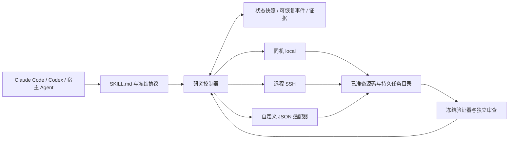

# Scientist Two Skill

[English](README.md) · [状态与门控规范](references/workflow.md) · [执行协议](references/executor-contract.md)

面向 **Claude Code、Codex，以及能读取 Skill 并执行命令的其他 Agent** 的可移植科研工作流。宿主 Agent 负责科研推理；Python 执行层负责证据、有限预算、可恢复任务和五阶段门控。演示不需要模型 SDK、API key、GPU、数据库或后台服务。

这是 [ScientistTwo](https://arxiv.org/abs/2609.19644) 的**独立、非官方适配**，也借鉴 [Karpathy autoresearch](https://github.com/karpathy/autoresearch) 的固定预算、baseline、实验账本和保留/舍弃机制。原论文的六个模块在这里归并为五阶段。**本项目没有复现论文的科研成绩。**论文的 86/107（80.4%）改进率及覆盖 49 项任务、1,814 条参考文献的完整性审计，属于作者在特定评测范围内的结果，不是本产品保证。分别核验的来源和许可见[参考说明](references/sources.md)。



## 安装

需要 **Linux 或 macOS、Python 3.10+**，以及支持 POSIX 文件锁与原子替换的文件系统；SSH 模式还需要 OpenSSH。执行层使用 POSIX 进程组，不支持原生 Windows，可使用合适的 Linux 环境。运行时不依赖第三方 Python 包。

```sh
git clone https://github.com/doubaoclaude-dotcom/scientist-two-skill.git
cd scientist-two-skill
```

从克隆目录运行，按宿主选择安装位置；目标目录必须尚不存在：

```sh
# Claude Code：个人技能
mkdir -p "$HOME/.claude/skills"
test ! -e "$HOME/.claude/skills/scientist-two" && \
  cp -R . "$HOME/.claude/skills/scientist-two"

# Codex：个人技能
mkdir -p "$HOME/.agents/skills"
test ! -e "$HOME/.agents/skills/scientist-two" && \
  cp -R . "$HOME/.agents/skills/scientist-two"
```

也可将技能目录复制到目标项目的 `.claude/skills/scientist-two` 或 `.agents/skills/scientist-two`。`scripts/`、`examples/`、`references/` 必须与 `SKILL.md` 一起安装。Claude Code 用 `/scientist-two` 调用，Codex 用 `$scientist-two` 调用。安装目录已按 [Claude Code 官方文档](https://code.claude.com/docs/en/skills)和 [Codex 官方文档](https://developers.openai.com/codex/skills/)核验。保留自动发现；`agents/openai.yaml` 提供可选的 Codex 界面信息，不指定模型供应商或模型。兼容性验证覆盖技能格式、官方发现路径和可移植脚本；尚未对 Claude Code/Codex 的实际交互科研会话做基准测试。

## 五分钟运行示例

在干净克隆中执行：

```sh
python3 examples/demo.py
python3 examples/demo.py --mode custom
python3 -m unittest discover -s tests -v
```

实际运行输出节选（2026-11-05）：

```json
{"baseline_score":0.5,"final_score":1.0,"gates":["S1","S2","S3","S4","S5"],"jobs":8,"mode":"local","synthetic":true}
```

分数是刻意构造的算术测试值，不是科研基准成绩。

示例执行确定性算术实验，从原始观测重算指标，并走通 S1–S5。其审查者身份和科研判断全部是**软件测试夹具**；不能作为真实独立审查。默认使用结束后自动清理的临时目录。需要保留状态和实验产物时，指定一个新目录：

```sh
python3 examples/demo.py --directory /tmp/scientist-two-demo
python3 scripts/study.py --state /tmp/scientist-two-demo/state.json status
```

示例会生成完整的 `config.json`。上述命令不调用模型、不联网。不要把其中的模拟审查意见用作真实研究的审计凭据。

## 接入训练与评测

参考示例生成的 `config.json` 和[完整配置/证据格式](references/workflow.md)，在第一次实验前固定目标、baseline、数据划分、主指标方向、最小实际收益、统计判据、保护指标、预算和停止条件。记录数据和评价器版本即可，各执行模式均不要求源码或结果哈希。`source_manifest` 仅用于可选的控制器本地文件变化跟踪，不需要时可直接省略。源码上传只允许显式清单；不默认上传数据、权重、日志、`.git`、生成结果或凭证。

`commands` 保存具名参数数组，提交时选择冻结的命令。实验应向环境变量 `SCIENTIST_RESULT_PATH` 指定的文件写入有限数值 JSON；`SCIENTIST_JOB_DIR` 可用于原始观测和日志。执行协议要求数值 `metrics.score`，其他具名指标可作为主指标或保护指标：

```python
import json, os
with open(os.environ["SCIENTIST_RESULT_PATH"], "w") as output:
    json.dump({"metrics": {"score": 0.75}}, output, allow_nan=False)
```

这里的 0.75 只是接口样例。请提供真正读取证据、重新计算指标并执行所需审计的验证器。验证器命令与文件在配置中冻结，通过 stdin/stdout 交换 JSON。`examples/validator.py` 仅演示算术任务，不能证明任意科研代码正确。验证器和自定义适配器是受信任的可执行程序，其权限应与研究授权匹配。配置和 manifest 不保存秘密或完整环境变量。

```sh
python3 scripts/study.py --state /absolute/study/state.json init --config /absolute/config.json
python3 scripts/study.py --state /absolute/study/state.json submit --job-id baseline-01 --kind baseline --command baseline
python3 scripts/study.py --state /absolute/study/state.json reconcile --job-id baseline-01
python3 scripts/study.py --state /absolute/study/state.json evidence --file /absolute/evidence-s1.json
python3 scripts/study.py --state /absolute/study/state.json gate --stage S1
```

预算采用**任务经过的墙钟秒数**，不是 CPU 秒或 GPU 小时。提交前预留完整单任务时限，终态按执行层报告的耗时结算；一次提交占用一个任务名额和一个迭代名额。需要 GPU 计量时，应接入已授权的计量扩展；当前版本不会伪造 GPU 消耗。安装技能本身不授权真实 GPU 基准或付费算力。

## 三种执行方式

共用 `submit`、`status`、`collect` 协议；状态包括 `preparing`、`running`、`succeeded`、`failed`、`unknown`。必填字段、JSON 大小限制、断线处理和转义规则见[执行协议](references/executor-contract.md)。

**local：控制器与算力同机**，包括云端机器：

```json
{"executor":{"mode":"local"},"execution":{"cwd":"/absolute/prepared/source","job_root":"/absolute/persistent/jobs"}}
```

使用上述控制器命令；`python3 examples/demo.py` 提供可运行的完整配置。分离的 worker 在调用进程退出后保留任务身份和日志。

**ssh：复用已有 SSH 主机别名和主机密钥信任**：

```json
{"executor":{"mode":"ssh","host":"research-host","python":"python3","executor_path":"/srv/scientist/executor.py"},"execution":{"cwd":"/srv/scientist/source","job_root":"/srv/scientist/jobs"}}
```

先在远端准备当前账号可写的目录，只复制批准文件。例如：

```sh
ssh research-host 'mkdir -p /srv/scientist/source /srv/scientist/jobs'
scp scripts/executor.py research-host:/srv/scientist/executor.py
scp examples/experiment.py research-host:/srv/scientist/source/experiment.py
```

按实际权限修改路径。`source_root` 指本地批准的源码树，`execution.cwd` 指远端对应目录；使用远端有效的命令路径即可。worker 直接运行已部署的文件，不再校验远端源码或结果哈希；本地 Git commit 不自动证明远端代码身份。没有自动整目录镜像或删除同步。可选 `config_file` 使用绝对路径指定已有 SSH 配置，映射为 `ssh -F`；保持主机验证，认证由现有 SSH 设施提供。升级已有部署时，也要把新版 `scripts/executor.py` 复制到远端执行入口；旧版远端脚本仍要求哈希校验。

配置后仍使用相同的 `init`、`submit`、`reconcile` 命令。`collect` 返回结果 JSON，远端原始文件仍在远端。**本地验证器若需要原始文件，必须显式收集允许的文件，并让验证器读取本地副本**；也可使用支持远端读取的验证器。记录收集文件的来源即可，不要求远端计算校验和。此版本不是通用的远端文件下载器。

**custom：通过参数数组启动适配程序，stdin/stdout 交换一个 JSON 请求和响应**：

```json
{"executor":{"mode":"custom","argv":["python3","/absolute/skill/examples/custom_adapter.py"]},"execution":{"cwd":"/absolute/prepared/source","job_root":"/absolute/persistent/jobs"}}
```

运行 `python3 examples/demo.py --mode custom` 可实际走通随仓库提供的适配器。接入调度器、SDK 或 API 时替换其内部逻辑，维持稳定任务 ID、真实状态和耗时报告。示意请求/响应：

```json
{"operation":"status","job_id":"study01-h01","job_root":"/absolute/persistent/jobs"}
```

```json
{"job_id":"study01-h01","status":"succeeded","exit_code":0,"elapsed_seconds":1.2,"job_dir":"/absolute/persistent/jobs/study01-h01","result":{"metrics":{"score":0.75}}}
```

stdout 只能放协议 JSON，诊断写 stderr 或日志。错误 ID、非法状态、超大响应、非有限数值及损坏 JSON 都会被拒绝。适配器返回进程状态和有效结果 JSON 即可，不必计算或返回哈希。

## 门控、恢复和历史

| 阶段 | 产物 | 目的 |
| --- | --- | --- |
| S1 | 匹配协议的 baseline、诊断、可证伪假设 | 固定评价与改动边界 |
| S2 | smoke、开发集初筛、确认、资源记录 | 收益、不确定性、保护指标与预算 |
| S3 | 消融/交互组、简化、复测 | 支持保留的科学组件 |
| S4 | 独立意见、新反驳实验、关闭记录 | 回应或撤回致命经验主张 |
| S5 | 数值、协议、引文、代码映射审计 | 同一最终版本，无未关闭致命问题 |

程序实际检查阶段顺序、产物身份、证据版本、任务完成、指标有效性、冻结验证器输出和预算。科学充分性、统计判据适用性、组件贡献、引文支持与代码语义仍依赖审查者判断。独立身份是记录的声明，不由程序认证。没有独立审查者时，运行 `review-package --output /absolute/review.json` 导出审查包，保留 pending 状态，不能冒充完成真实审查。

每项研究使用一个显式状态路径。文件锁串行化更新；包含完整状态的追加事件先于原子快照落盘，支持中断恢复。重开后执行 `status` 和 `reconcile --job-id 原ID`。**提交超时后不可换一个新 ID 直接重提。**unknown 任务继续占用预留额度，直至核对清楚。失败、负结果和历史证据均保留，日志位于记录的任务目录。

源码、配置或协议发生变化时，用 `revise --config FILE --reason TEXT` 显式修订。版本变化会使 gate 标记 stale，历史证据继续保留，但不能支持新版本。按当前版本重新建立相关阶段证据。合法结束包括 `negative`、`inconclusive`、`budget_exhausted`，用 `finish --outcome 其中一个状态 --reason TEXT` 记录。恢复文件不会在聊天结束后唤醒宿主 Agent。拥有任意文件写权限的进程可改写记录，因此门控属于流程防错，不是安全隔离。

## 验证、限制与贡献

执行 `python3 -m unittest discover -s tests -v`。测试覆盖 local/custom、非零退出、超时、缺失/损坏结果、重复 ID、unknown、预算与门控拒绝、版本漂移、事件/快照间中断恢复，以及完整五阶段软件链路。SSH 转义和断线有模拟测试，另在 macOS 上通过了真实隔离 localhost SSH 测试；它使用临时密钥和仅监听回环地址的服务，不修改用户 SSH 文件。可显式运行 `SCIENTIST_TEST_SSH=1 python3 -m unittest discover -s tests -p test_ssh_real.py -v`（需要 `sshd` 及启动权限），不代表真实云端环境已验证。CI 在 Linux 的 Python 3.10 和 3.14 下运行。测试证明软件行为，不证明科研结论。

当前版本为 POSIX 上单控制器、文件状态的轻量工作流，没有常驻 Agent 调度服务、真实模型基准、原生 Windows 支持、凭证管理器、数据集上传系统或自动远程产物下载。实验日志/数据没有磁盘配额控制。真实训练需要你确定数据规则、评价器、冻结基准和明确算力预算；外部命令依赖和运行环境也需单独记录可复现身份。

贡献请提供可复现的小测试，保留标准库运行时和共用执行协议；涉及用户行为的变更同步更新双语 README，并运行受影响测试。通过 pull request 提交，不夹带凭证、数据集、内部地址或生成的研究产物。原创代码与文档采用 [MIT](LICENSE)，参考项目各自许可见[来源说明](references/sources.md)。

**软件闭环验收通过，不等于已经复现论文的科研成绩；后续应在预先固定的基准与预算下比较不同研究流程的效果。**
